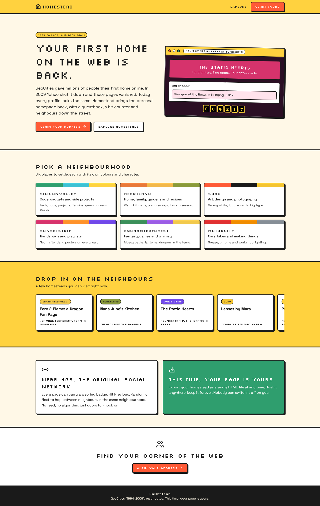
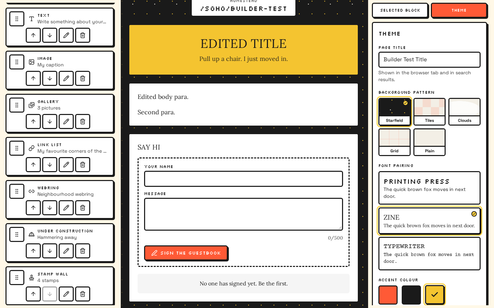
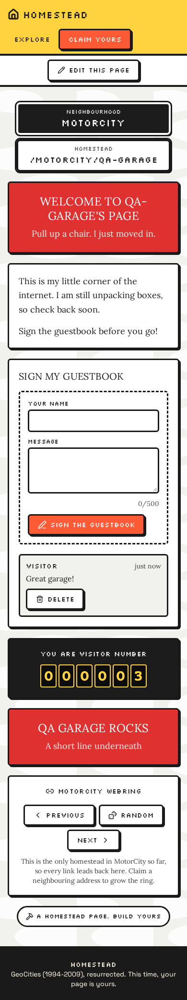

# Homestead

**GeoCities, resurrected.** Claim an address in a themed neighbourhood, build a personal homepage with a visual editor, get a guestbook and a hit counter, hop a webring, and export your page as a single HTML file.

## The story

From 1994 to 2009 GeoCities gave millions of people their first home on the web: an address in a neighbourhood like `/SunsetStrip/`, a page full of personality, a guestbook and a hit counter. In 2009 Yahoo shut it down and those pages vanished. Today most online identity is a uniform profile. Homestead brings the personal homepage back and fixes the part that hurt: **this time, your page is yours.** Export it at any time and host it anywhere.



## Features

- Landing page that tells the story, six neighbourhoods and sample homesteads
- Claim an address `/<neighbourhood>/<name>` with live availability and plain-word rules
- Visual builder with 11 blocks: header, text, image, gallery, link list, guestbook, hit counter, webring badge, divider, under construction, stamp wall
- Drag to reorder, keyboard move buttons, side-panel editing, delete with confirm
- Theme: 5 background patterns tinted per neighbourhood, 3 font pairs, neighbourhood accents
- Autosave and publish, with a live preview that uses the same renderer as the public page
- Public page with a vintage street sign, guestbook (plain text, owner delete) and animated hit counter
- Per-neighbourhood webring: previous, random, next, with a single-page fallback
- Explore with live counts, newest pages and Surprise me
- Export to one self-contained HTML file that renders offline
- Five seeded sample homesteads, themed 404, SEO tags, favicon, 390px and 1440px layouts




## Tech stack

React, Vite, TypeScript (strict), Tailwind CSS v4, React Router, dnd-kit, lucide-react, Supabase (optional), Vitest, Playwright for QA.

Data goes through one `Repo` interface with two implementations: `localRepo` (localStorage, demo mode) and `supabaseRepo`. Blocks are a discriminated union stored as `jsonb`, so one renderer serves the builder preview, the public page and the exporter.

## How Kiro was used

- **Specs:** `.kiro/specs/homestead/` holds `requirements.md` (user stories with acceptance criteria), `design.md` and `tasks.md`, the build order ticked off as work landed.
- **Steering:** `.kiro/steering/product.md`, `design.md` and `tech.md` keep product voice, design rules (no emoji icons, pixel font for headings and labels only) and stack conventions consistent.
- **Hook:** `.kiro/hooks/spec-task-build.kiro.hook` runs `npm run build` whenever a task in `tasks.md` is ticked.
- **MCP:** none configured, so the database schema is written as SQL in `supabase/migrations/` instead of being applied through an MCP server. The migrations were checked against an in-process Postgres (PGlite) instead. See `DECISIONS.md`.
- **Autonomous build:** Kiro sub-agents implemented the plan feature by feature from the specs, ran the build, tests and Playwright scripts after each one, and kept `QA.md`, `STATUS.md` and `DECISIONS.md` current.

## Run locally

```bash
npm install
npm run dev           # http://localhost:5173
npm run build         # type-check and production build
npm test              # unit tests
node scripts/qa.mjs   # after build: end-to-end flow and screenshots (needs `npx playwright install chromium`)
```

With no env vars the app runs entirely on localStorage. Everything works, per browser.

## Environment variables (optional)

| Name | Purpose |
|---|---|
| `VITE_SUPABASE_URL` | Supabase project URL |
| `VITE_SUPABASE_ANON_KEY` | Supabase anon public key |

Leave both unset for **demo mode** (everything in the visitor's browser). Set both to switch to the Supabase repository. See `.env.example`.

### Supabase mode and security

Apply the migrations in `supabase/migrations/` in filename order: `20250101000000_init.sql`, then `20250102000000_owner_edit_token.sql`. The second one replaces the open update/delete rules with an owner edit token. At claim, the browser makes a random token, keeps it in localStorage and stores only its SHA-256 hash. Saving a page and deleting a guestbook entry go through RPCs (`update_homestead`, `delete_guestbook_entry`) that check the token. The anon role cannot update or delete rows directly and cannot read the hash.

What this cannot protect: clearing browser storage or switching device loses the token, so the page can no longer be edited (export your page to keep a copy). Anyone who gets the token is the owner. Anyone can still claim a free address, post guestbook entries within the length limits (the signing cooldown is client-side), and bump counters. Sample pages have no token and are read-only. Pages claimed before the second migration become read-only. Details are in `.kiro/specs/homestead/design.md` and `BLOCKERS.md`.

On first load against a database, the app inserts the five sample homesteads, their guestbook entries and starting counters if they are missing. This is safe to repeat.

Test the migrations without a Supabase project: `node scripts/migration-test.mjs` runs them in an in-process Postgres (PGlite) and checks the rules as the anon role.

## Deploy to Vercel

1. Push the repo to GitHub. In Vercel choose **Add New > Project**, import `shuaib-mk/homestead`, framework preset **Vite**.
2. Build command `npm run build`. Output directory `dist`. Install command `npm install`.
3. Environment variables: none are required. To use Supabase add `VITE_SUPABASE_URL` and `VITE_SUPABASE_ANON_KEY` (Project settings > API) for Production and Preview.
4. Supabase only: create a project, open the SQL editor, and run the two migration files in order (`20250101000000_init.sql`, then `20250102000000_owner_edit_token.sql`). Then redeploy so the build picks up the env vars.
5. Deploy. `vercel.json` rewrites every path to `index.html`, so deep links like `/soho/lenses-by-mara` work.
6. To stay in demo mode, leave both variables unset (or delete them and redeploy). The variables are read at build time, so any change needs a redeploy.
7. Verify: open the live URL, claim an address, edit, publish, sign the guestbook, reload and check the counter.

## Going public + submission checklist

- [x] GitHub repo is public
- [x] `LICENSE` (MIT) is in the repo
- [x] Live URL: https://homestead-seven-gray.vercel.app (deep links such as `/soho/lenses-by-mara` and the 404 page work)
- [ ] If using Supabase: migrations applied in order, env vars set, one click-through of claim, save, sign, delete entry
- [x] Run `npm run build`, `npm test` and the scripts in `scripts/`; see `QA.md`
- [ ] Demo video notes: land, claim an address, add and reorder blocks, change the theme, publish, sign the guestbook, watch the counter tick, hop the webring, export and open the file; mention the Kiro specs, steering and hook
- [ ] Add the video link to this README

## More

`QA.md` (checklist), `DECISIONS.md`, `STATUS.md`, `BLOCKERS.md`.

## License

MIT
